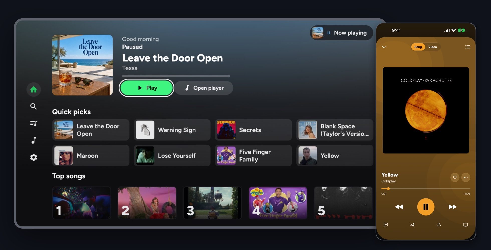
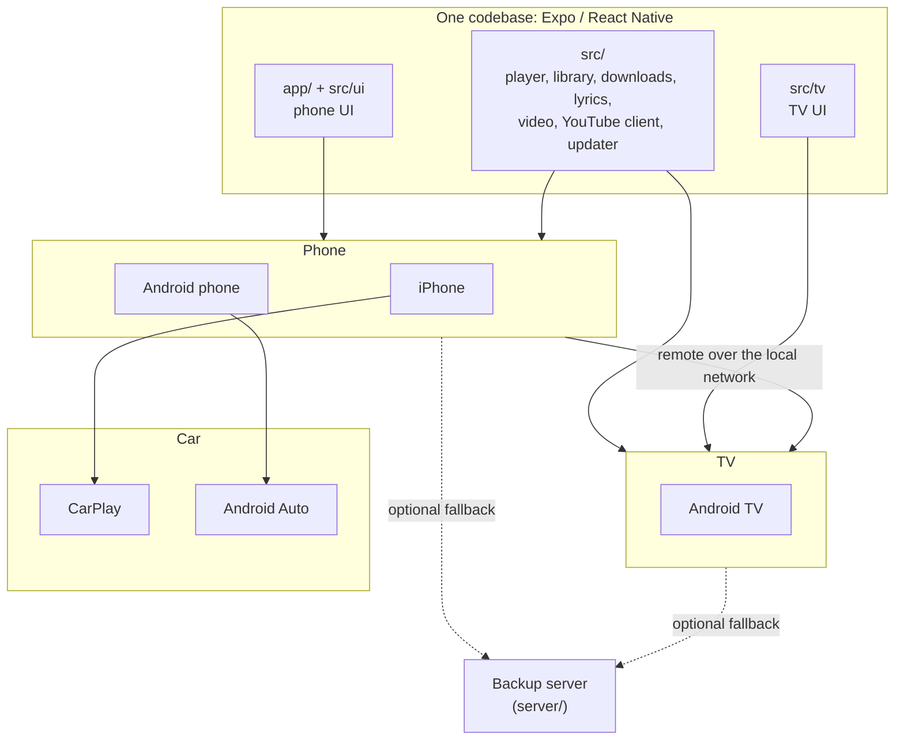
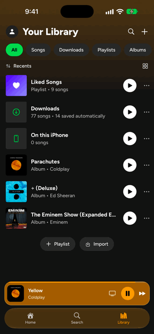
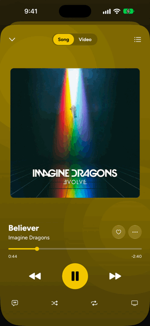
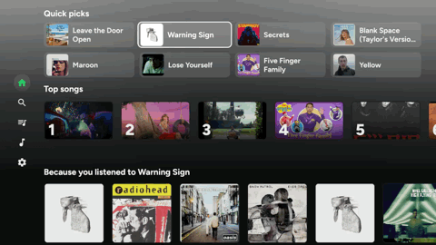
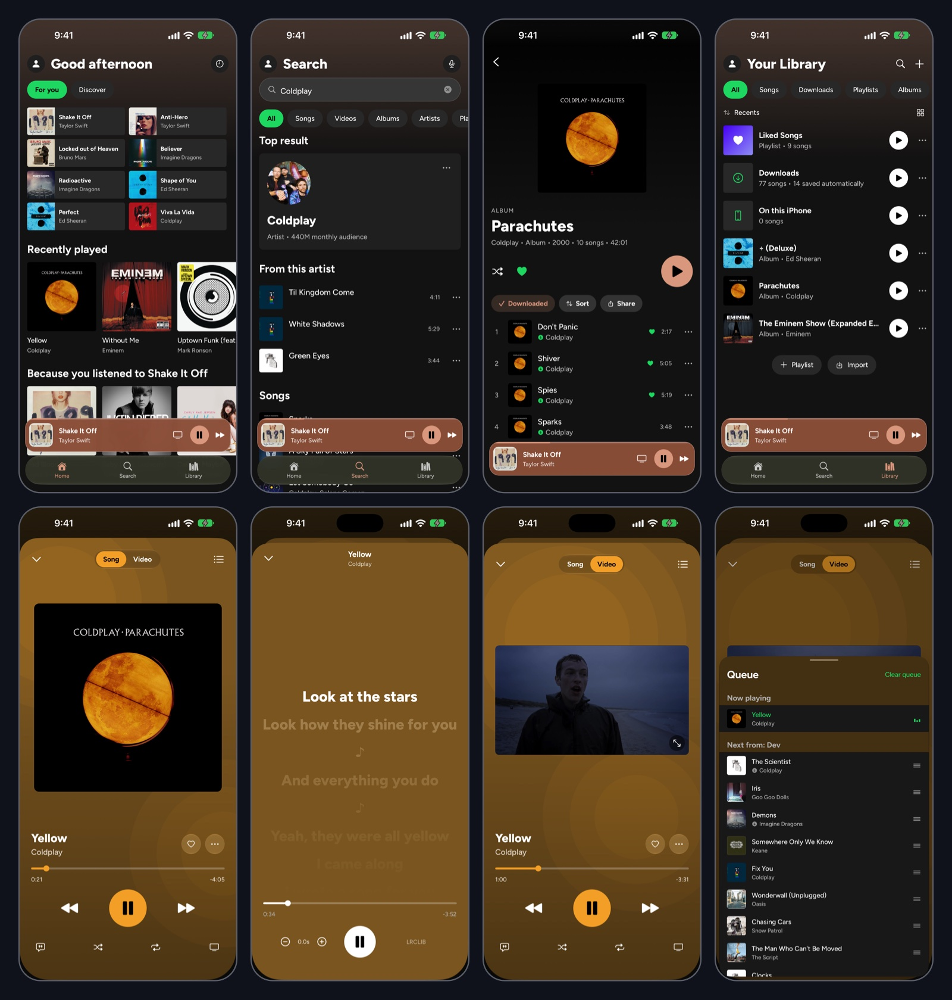
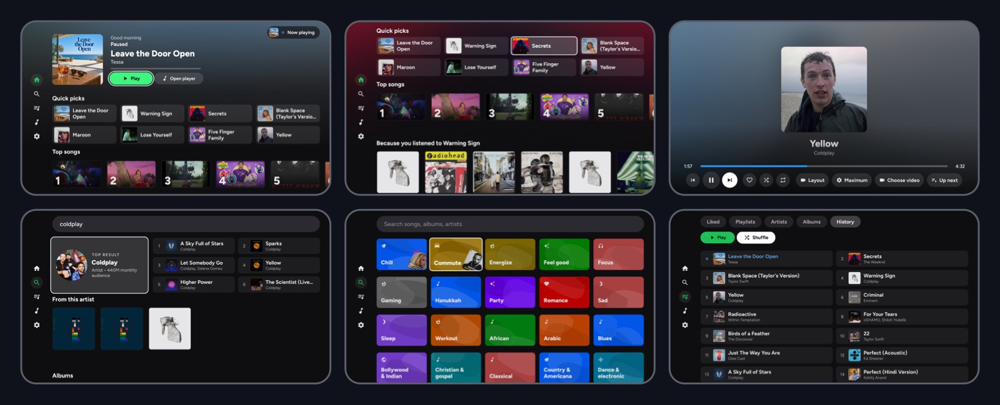

<div align="center">


# Sangeet

**An open-source music player for iPhone, Android and Android TV, built from one React Native codebase.**


[](./LICENSE)



</div>

## Summary

Sangeet is a music player for iPhone, Android phones and Android TV that shares a single TypeScript codebase. The
iPhone app works with CarPlay and Siri, the Android app works with Android Auto, and the TV app has a full D-pad
interface. Either phone can control the TV over the local network. You can search and play, follow synced lyrics,
switch between a song and its music video at the same position, save music for offline listening, and keep your
library in sync. Streams are resolved on the device, with an optional self-hosted backup server. There are no ads,
no analytics and no tracking.

## Highlights

<table>
  <tr>
    <td width="33%"><b>Offline first</b><br>Background downloads, an automatic offline cache and an offline Home.</td>
    <td width="33%"><b>Synced lyrics</b><br>Several lyric sources, a timing clock and a sync control.</td>
    <td width="33%"><b>Song &harr; Video</b><br>Switch to the music video at the same position, full-screen in landscape.</td>
  </tr>
  <tr>
    <td><b>Phone &rarr; TV remote</b><br>iPhone or Android finds the TV on your network, plays on it and mirrors its state.</td>
    <td><b>In the car</b><br>CarPlay and Android Auto: browse your library and search by voice.</td>
    <td><b>Voice</b><br>"Play &hellip; on Sangeet" with Siri or Google Assistant, plus in-app voice search.</td>
  </tr>
  <tr>
    <td><b>Your library</b><br>Likes, playlists and followed artists, optionally synced with YouTube Music.</td>
    <td><b>Local files and imports</b><br>Add audio files from your phone, import Spotify playlists, open shared links.</td>
    <td><b>Self-updating on Android</b><br>Phone and TV install each release from GitHub, never during playback.</td>
  </tr>
</table>

## Ecosystem

### Phone

| App | Status | Notes |
| --- | --- | --- |
| **iPhone** | Ready | The main app, with Siri ("Play &hellip; on Sangeet", requires a paid Apple team). Distributed to testers through TestFlight or Firebase App Distribution (Ad Hoc). |
| **Android phone** | Ready | The phone interface on Android: media notification and lock-screen controls, songs from your phone, links shared from other apps and in-app updates. See [docs/INSTALL-ANDROID.md](./docs/INSTALL-ANDROID.md). |

### Car

| App | Status | Notes |
| --- | --- | --- |
| **CarPlay** | Included, set up yourself | Home, Library, Recents and Downloads in the car; search through Siri. Shipping it needs the CarPlay audio entitlement from Apple for your bundle ID, enabled on your App ID, and a build with `SANGEET_CARPLAY=1`. Simulator builds include it, so it runs in the iOS Simulator's CarPlay window (I/O > External Displays > CarPlay) before Apple approves. |
| **Android Auto** | Included | Home, Library, Recents, Downloads and recent searches in the car, with search by voice (keyboard when parked) and "Hey Google, play &hellip; on Sangeet". Build switch `SANGEET_ANDROID_AUTO` (default on). Covered by unit tests; not yet tested on a head unit. |

### TV

| App | Status | Notes |
| --- | --- | --- |
| **Android TV** | Ready | Full D-pad interface, built for the Google TV Streamer, with in-app updates. Controlled from either phone over the local network (discovery, playback and state mirroring). See [docs/INSTALL-TV.md](./docs/INSTALL-TV.md). |
| **Apple TV** | Not planned | |

### Services

| Service | Status | Notes |
| --- | --- | --- |
| **Backup stream server** | Optional | Self-hosted Python server for when on-device stream resolving fails. See [server/README.md](./server/README.md). |

Android phones and Android TV share one APK; the interface is chosen at launch.



The phone interface (`app/`, `src/ui/`) and the TV interface (`src/tv/`) are chosen at runtime with
`Platform.isTV`; Android differences in shared screens are gated to Android so the iPhone app is unaffected. Native
pieces live in local Expo modules (`modules/`): the localhost stream proxy, audio events, the phone-to-TV remote,
Siri, TV key handling, the audio output picker, shared links and the Android updater.

## See it in action

<table>
  <tr>
    <td align="center"></td>
    <td align="center"></td>
    <td align="center"></td>
  </tr>
  <tr>
    <td align="center">Home: shelves made from what you play</td>
    <td align="center">Library and Downloads, playable offline</td>
    <td align="center">Now Playing to lyrics that follow the song</td>
  </tr>
</table>

<table>
  <tr>
    <td align="center"></td>
    <td align="center"></td>
  </tr>
  <tr>
    <td align="center">Android TV: D-pad browsing across shelves and the left rail</td>
    <td align="center">Android TV: one song, every layout: video, video + lyrics, overlay, music + lyrics, lyrics, music</td>
  </tr>
</table>

## Screenshots

### Phone



### Android TV



## Tech stack

- **App:** Expo SDK 58 (Continuous Native Generation), React Native 0.88, TypeScript, expo-router
- **Playback:** [react-native-nitro-player](https://github.com/riteshshukla04/react-native-nitro-player) on AVPlayer (iOS) and Media3 ExoPlayer (Android), including CarPlay and Android Auto
- **Streams:** youtubei.js in a hidden WebView extractor, resolved on the device
- **Data:** TanStack Query, SQLite, MMKV
- **Release:** changesets, GitHub Actions, Fastlane (match for signing), Firebase App Distribution

## Getting started

Requires Node and npm. The iPhone app needs Xcode and CocoaPods; the Android apps need JDK 17 and the Android SDK
(Android Studio is optional). Set `LANG=en_US.UTF-8` for `expo prebuild` and CocoaPods.

```sh
cp .env.local.example .env.local        # set SANGEET_BUNDLE_ID (your own bundle ID) and APPLE_TEAM
npm install
npx expo run:ios                        # iPhone simulator
scripts/device-build.sh ios             # iPhone release build (INSTALL=1 installs)
scripts/android-tv-release.sh           # signed Android APK for phones and TV: dist/sangeet-tv.apk
scripts/device-build.sh tv              # Android TV build (INSTALL=1 installs over adb)
```

`ios/` and `android/` are generated by Expo and git-ignored; change `app.config.ts`, a plugin or a module instead of
editing them. Install guides: [iPhone](./docs/INSTALL.md), [Android phone](./docs/INSTALL-ANDROID.md),
[Android TV](./docs/INSTALL-TV.md).

## Release

Versions are managed with [changesets](https://github.com/changesets/changesets): every user-visible change adds
one (`npx changeset`). Nothing ships until the release pull request is merged:

1. **Checks** runs the type check, lint and tests on every pull request and on `main`.
2. **Version** keeps one release pull request up to date as changes land on `main`, with the version bump and
   `CHANGELOG.md`. It builds nothing.
3. **Release** starts when that pull request is merged (or by hand). It runs the checks, builds the iPhone app for
   testers (Firebase App Distribution or TestFlight) and the signed universal Android APK, then publishes a GitHub
   Release with the notes and the APK. Installed Android apps pick up the release through the in-app updater.

Build logs are kept private: the public log shows step results and a summary, and the full logs are stored
encrypted. Signing uses Fastlane match with your own bundle ID (`$SANGEET_BUNDLE_ID`); settings live in git-ignored
env files (see `.env.testflight.example`). The iOS lanes also run from a Mac:

```sh
scripts/testflight.sh                   # checks, build, upload to TestFlight
scripts/testflight.sh adhoc             # checks, Ad Hoc build, upload to Firebase App Distribution
DRY_RUN=1 scripts/testflight.sh         # build and sign only
scripts/testflight.sh release-prep      # screenshots + App Store listing (never submits for review)
```

Details: [docs/INSTALL.md](./docs/INSTALL.md).

## Project structure

| Path | What it is |
| --- | --- |
| `app/` | Phone screens (expo-router) |
| `src/` | App code shared by phone and TV (folder map in [docs/STATUS.md](./docs/STATUS.md)) |
| `modules/` | Local Expo modules (Swift / Kotlin) |
| `plugins/` | Expo config plugins (Android manifest: TV, shared links, Android Auto) |
| `patches/` | patch-package fixes to npm packages |
| `server/` | Optional backup stream server |
| `fastlane/` | TestFlight, Ad Hoc and App Store lanes, listing text, screenshots |
| `scripts/` | Device builds, release and CI helpers, screenshots, collages, perf scripts |
| `.changeset/` | Pending release notes (see its README) |
| `.github/workflows/` | **Checks**, **Version** (release PR) and **Release** workflows |
| `docs/` | Status, install guides, privacy policy |

## Contributing

Run the checks before opening a pull request; the Checks workflow runs them on every pull request, and Release runs
them again before every build. Add a changeset for any user-visible change.

```sh
npx tsc --noEmit && npx eslint src app && npx jest
npx changeset
```

Architecture, build notes and open items: [docs/STATUS.md](./docs/STATUS.md). Guidance for AI coding agents:
[AGENTS.md](./AGENTS.md). Privacy policy: [docs/privacy-policy.md](./docs/privacy-policy.md).

## Disclaimer

Sangeet is an independent project. It is not affiliated with or endorsed by YouTube or Google.

## License

MIT, see [LICENSE](./LICENSE).
