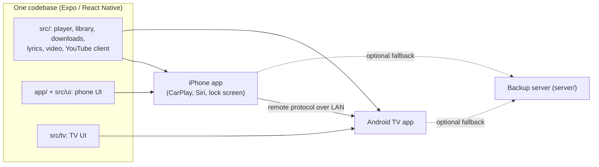
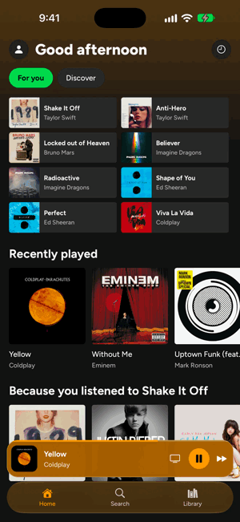

<div align="center">


# Sangeet

**An open-source music player for iPhone and Android TV, built from one React Native codebase.**


[](./LICENSE)


</div>

## Summary

Sangeet is a music player for iPhone and Android TV that shares a single TypeScript codebase. The iPhone app
adds CarPlay and Siri, the Android TV app has a full D-pad interface, and the phone can act as a remote for
the TV over the local network. An optional self-hosted backup server covers the case where on-device stream
resolving fails. You can search and play, follow synced lyrics, switch between the song and its music video
at the same position, save music for offline, and keep your library in sync. There are no ads, no analytics
and no tracking.

## Highlights

<table>
  <tr>
    <td width="33%"><b>Offline first</b><br>Background downloads plus an automatic offline cache, with an offline Home.</td>
    <td width="33%"><b>Synced lyrics</b><br>Several lyric sources, a timing clock and a sync control.</td>
    <td width="33%"><b>Song &harr; Video</b><br>Switch to the music video on the same position, full-screen landscape.</td>
  </tr>
  <tr>
    <td><b>Phone &rarr; TV remote</b><br>The iPhone finds the TV on your network, plays on it and mirrors its state.</td>
    <td><b>CarPlay &amp; Siri</b><br>Lock screen, Control Center, CarPlay and "Play &hellip; on Sangeet".</td>
    <td><b>Your library</b><br>Likes, playlists and followed artists, optionally synced with YouTube Music.</td>
  </tr>
  <tr>
    <td><b>Local files</b><br>Import audio files from this iPhone through Files.</td>
    <td><b>Playlist import</b><br>Bring in Spotify playlists, matched to playable songs.</td>
    <td><b>Privacy</b><br>No ads, analytics or tracking. Stream resolving runs on the device.</td>
  </tr>
</table>

## Ecosystem

| Target | Status | Notes |
| --- | --- | --- |
| **iPhone** | Ready | Main app, distributed through TestFlight (internal testing). |
| **CarPlay** | Included, set up yourself | Fully built into the iPhone app (Home, Library, Recents, Downloads). To ship it, request the CarPlay audio entitlement from Apple for your own bundle ID, enable it on your App ID, then build with `SANGEET_CARPLAY=1`. Simulator builds include it, so it can be tried in the iOS Simulator's CarPlay window (I/O > External Displays > CarPlay) before Apple approves. |
| **Siri** | Ready | "Play &hellip; on Sangeet" through the iPhone app (paid Apple team). |
| **Android TV** | Ready | Full D-pad UI, built for the Google TV Streamer. Sideloaded with `adb`. |
| **Phone &rarr; TV remote** | Ready | Local-network discovery, playback and state mirroring. |
| **Backup stream server** | Optional | Self-hosted Python server, see [server/README.md](./server/README.md). |
| **Android phone** | Planned | The shared code already runs on Android; the phone UI is not built yet. |
| **Android Auto** | Planned | Car UI for the Android phone app, the counterpart of CarPlay. |



The phone UI (`app/`, `src/ui/`) and the TV UI (`src/tv/`) are chosen at runtime with `Platform.isTV`. Native
pieces live in local Expo modules (`modules/`): a localhost stream proxy, audio events, the phone-to-TV remote
server, Siri, TV key handling and the AirPlay route picker.

## See it in action

<table>
  <tr>
    <td align="center"></td>
    <td align="center"></td>
    <td align="center"></td>
  </tr>
  <tr>
    <td align="center">Home: shelves made from what you play</td>
    <td align="center">Library and Downloads, playable offline</td>
    <td align="center">Now Playing to lyrics that follow the song</td>
  </tr>
</table>

<table>
  <tr>
    <td align="center"></td>
    <td align="center"></td>
  </tr>
  <tr>
    <td align="center">Android TV: D-pad browsing across shelves and the left rail</td>
    <td align="center">Android TV: one song, every layout: video, video + lyrics, overlay, music + lyrics, lyrics, music</td>
  </tr>
</table>

## Screenshots

### iPhone


### Android TV


## Tech stack

- **App:** Expo SDK 58 (Continuous Native Generation), React Native 0.88, TypeScript, expo-router
- **Playback:** [react-native-nitro-player](https://github.com/riteshshukla04/react-native-nitro-player) on AVPlayer (iOS) and Media3 ExoPlayer (Android)
- **Streams:** youtubei.js running in a hidden WebView extractor, resolved on the device
- **Data:** TanStack Query, SQLite, MMKV
- **Release:** Fastlane (match for signing)

## Getting started

Requires Xcode, Node and CocoaPods; the TV app also needs JDK 17 and the Android SDK. Use npm and set
`LANG=en_US.UTF-8` for `expo prebuild` and CocoaPods.

```sh
cp .env.local.example .env.local        # set SANGEET_BUNDLE_ID (your own bundle ID) and APPLE_TEAM
npm install
npx expo run:ios                        # iPhone simulator
scripts/device-build.sh ios             # iPhone release build (INSTALL=1 installs)
scripts/device-build.sh tv              # Android TV APK (INSTALL=1 installs over adb)
```

`ios/` and `android/` are generated by Expo and git-ignored; change `app.config.ts`, a plugin or a module
instead of editing them. Install guides: [iPhone](./docs/INSTALL.md), [Android TV](./docs/INSTALL-TV.md).

## Release

Fastlane drives the iOS release from your own Mac (an unused GitHub Actions template is in
`.github/workflows/testflight.yml`). Signing uses Fastlane match with your own bundle ID
(`$SANGEET_BUNDLE_ID`); settings live in the git-ignored `.env.testflight` (see `.env.testflight.example`).

```sh
scripts/testflight.sh                   # checks, build, upload to TestFlight
DRY_RUN=1 scripts/testflight.sh         # build and sign only
scripts/testflight.sh release-prep      # screenshots + App Store listing (never submits for review)
```

Details: [docs/INSTALL.md](./docs/INSTALL.md#3-testflight).

## Project structure

| Path | What it is |
| --- | --- |
| `app/` | Phone screens (expo-router) |
| `src/` | App code shared by phone and TV (folder map in [docs/STATUS.md](./docs/STATUS.md)) |
| `modules/` | Local Expo modules (Swift / Kotlin) |
| `plugins/` | Expo config plugins (Android TV manifest) |
| `patches/` | patch-package fixes to npm packages |
| `server/` | Optional backup stream server |
| `fastlane/` | TestFlight and App Store lanes, listing text, screenshots |
| `scripts/` | Device builds, TestFlight, screenshots, collages, TV release and perf scripts |
| `docs/` | Status, install guides, privacy policy |

## Contributing

Run the checks before opening a pull request; the TestFlight lane runs the same gate before every upload.

```sh
npx tsc --noEmit && npx eslint src app && npx jest
```

Architecture, build notes and open items: [docs/STATUS.md](./docs/STATUS.md). Privacy policy:
[docs/privacy-policy.md](./docs/privacy-policy.md).

## Disclaimer

Sangeet is an independent project. It is not affiliated with or endorsed by YouTube or Google.

## License

MIT, see [LICENSE](./LICENSE).
